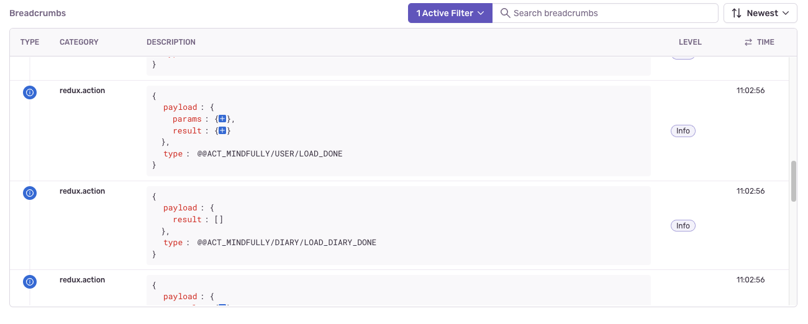
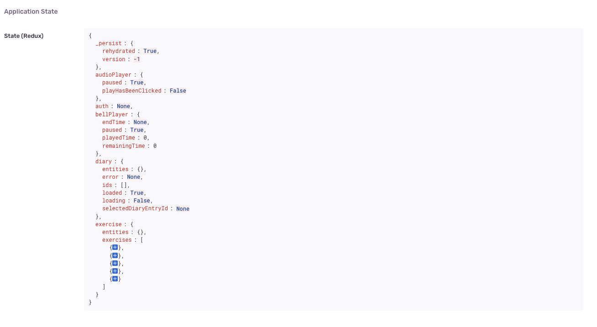

[](https://github.com/marcoturi/react-redux-boilerplate/blob/main/LICENSE)  

A production-ready, batteries-included starter template for building long-lived React applications. It provides opinionated guidelines for the key decisions every team faces at scale:

- **Folder structure** -- [Vertical slice architecture](#folder-structure-and-code-organization) for maintainability and easy extraction into a monorepo.
- **State management** -- [Redux Toolkit 2](#state-management-why-redux) for predictable, traceable state with clear separation of concerns.
- **Release automation** -- [Semantic-release](#release-system) for hands-off versioning, changelogs, and tags.
- **Code quality** -- [Biome](#format-and-style) for blazing-fast linting and formatting in a single tool.
- **UI system** -- [Radix + shadcn/ui + Tailwind CSS 4](#ui-components-and-style-system) for accessible, headless, minimal-dependency components.
- **Testing** -- [Vitest + Testing Library](#testing) for unit tests (Node) and component tests (browser mode), [Cucumber + Playwright](#testing) for E2E.
- **Error tracking** -- [Sentry](#error-handling-and-analytics) with Redux state replay for production debugging.

## Features

| Category                 | Stack                                                                                                                                                                                                                                                                     |
| ------------------------ | ------------------------------------------------------------------------------------------------------------------------------------------------------------------------------------------------------------------------------------------------------------------------- |
| Build                    | [Vite 8](https://vite.dev/) + [React 19](https://react.dev/) + [@vitejs/plugin-react](https://github.com/vitejs/vite-plugin-react) + [React Compiler](https://react.dev/learn/react-compiler) + [pnpm](https://pnpm.io/) + [TypeScript 7](https://www.typescriptlang.org) |
| State                    | [Redux Toolkit 2](https://redux.js.org/toolkit/) (includes RTK Query, Immer, Reselect)                                                                                                                                                                                    |
| UI                       | [Radix](https://www.radix-ui.com/) + [shadcn/ui](https://ui.shadcn.com/) + [Tailwind CSS 4](https://tailwindcss.com/)                                                                                                                                                     |
| Linting & formatting     | [Biome](https://biomejs.dev/)                                                                                                                                                                                                                                             |
| Release                  | [Husky](https://github.com/typicode/husky) + [Commitlint](https://commitlint.js.org/) + [Semantic-release](https://github.com/semantic-release/semantic-release)                                                                                                          |
| API mocking              | [MSW](https://mswjs.io/) (browser + test)                                                                                                                                                                                                                                 |
| Unit & integration tests | [Vitest 5](https://vitest.dev/) + [Testing Library](https://testing-library.com/)                                                                                                                                                                                         |
| E2E tests                | [Cucumber](https://cucumber.io/docs/installation/javascript/) + [Playwright](https://playwright.dev/)                                                                                                                                                                     |
| Monitoring               | [Sentry](https://github.com/getsentry/sentry-javascript/tree/master/packages/react)                                                                                                                                                                                       |
| Security                 | [CodeQL](https://github.com/github/codeql-action) analysis of the code and the workflows on pushes and pull requests to `main`, and weekly                                                                                                                                |
| AI-Ready                 | [AGENTS.md](AGENTS.md) — architecture rules and coding conventions for AI assistants                                                                                                                                                                                      |

## Getting Started

### Prerequisites

| Requirement | Version | Notes                                                                                                                        |
| ----------- | ------- | ---------------------------------------------------------------------------------------------------------------------------- |
| Node.js     | 26.x    | Defined in `.nvmrc`. Use [fnm](https://github.com/Schniz/fnm) or [nvm](https://github.com/nvm-sh/nvm): `fnm use` / `nvm use` |
| pnpm        | 12.x    | Pinned in `packageManager`: install pnpm with `npm i -g pnpm`, and it switches to that version by itself                     |

### Quick start

```bash
npx degit marcoturi/react-redux-boilerplate my-app
cd my-app
git init           # Husky installs the Git hooks only in a repository

pnpm install       # Install dependencies
pnpm create:env    # Create .env from .env.example
pnpm dev           # Start dev server at http://localhost:5173

# Chromium for the component tests, the E2E tests and the pre-commit hook
pnpm exec playwright install chromium
```

degit also copies the boilerplate's release history and names: delete `CHANGELOG.md`, set `name`, `description` and `author` in `package.json` and `version` to `0.0.0` (Sentry reports it as the release until semantic-release sets the first one), and change the title in `index.html` and `src/UI/Layout/Header/Logo.tsx`.

### Environment variables

| Variable           | Required | Description                                                                              |
| ------------------ | -------- | ---------------------------------------------------------------------------------------- |
| `VITE_API_URL`     | Yes      | Base URL of the API, inlined by `pnpm build`: without it the built app stops at startup  |
| `VITE_API_MOCKING` | No       | `true` serves the API from the MSW handlers on the dev server; keep it for the E2E tests |
| `VITE_SENTRY_DSN`  | No       | Sentry DSN: only builds report, and only when it is set                                  |

### Commands

| Command              | Description                                                   |
| -------------------- | ------------------------------------------------------------- |
| `pnpm dev`           | Start development server with HMR                             |
| `pnpm build`         | Type-check + production build (output in `dist/`)             |
| `pnpm preview`       | Preview the production build locally                          |
| `pnpm test`          | Run unit and component tests (Vitest, components in Chromium) |
| `pnpm test:coverage` | Run tests with V8 coverage and its thresholds                 |
| `pnpm e2e:local`     | Run E2E tests (start dev server first in another terminal)    |
| `pnpm e2e:debug`     | Run only `@only`-tagged E2E scenarios with `--fail-fast`      |
| `pnpm check`         | Biome lint/format check + TypeScript type check               |
| `pnpm check:fix`     | Auto-fix lint/format issues, then type check                  |
| `pnpm check:ci`      | `pnpm check` for CI, with Biome annotations on pull requests  |
| `pnpm format`        | Format all files with Biome                                   |
| `pnpm lint`          | Lint all files with Biome (`pnpm lint:fix` applies fixes)     |
| `pnpm type:check`    | TypeScript type check only (`tsc -b`)                         |

## Folder Structure and Code Organization

> **TL;DR** -- Embrace [vertical slice architecture](https://www.jimmybogard.com/vertical-slice-architecture/). Each feature owns its components, state, API calls, and tests.

```
src/
├── main.tsx                  → App entry point
├── AppProvider.tsx           → Providers (Redux, RouterProvider)
├── assets/                   → Static files (images, fonts, etc.)
├── routes/                   → Data router (client-side SPA, no SSR) + page components
│   ├── index.tsx             → Route tree: layout, layout and page ErrorBoundary, loaders, lazy pages
│   ├── Home/
│   ├── Subscriptions/
│   └── NotFound/
├── shared/
│   ├── config/               → Environment variables, Sentry setup
│   ├── helpers/              → Generic utilities (localStorage, error tracking, etc.)
│   └── store/                → Redux store setup, base RTK Query API, typed hooks
├── UI/
│   ├── Base/                 → shadcn/ui components, managed by the shadcn CLI
│   ├── Elements/             → Project UI components built on Base and Tailwind
│   └── Layout/               → Header and global CSS (theme)
├── features/                 → Feature slices
│   └── <feature>/
│       ├── store/            → Redux slice, selectors, API endpoints, effects, types, specs
│       └── components/       → Feature-specific React components
├── mocks/                    → MSW handlers and mock data, browser worker, Node server
└── test/                     → Test helpers and Vitest setup files
```

Why vertical slices over alternatives like [Atomic Design](https://atomicdesign.bradfrost.com/chapter-2/) or [Feature-Sliced Design](https://feature-sliced.design/)?

1. **Less navigation** -- Feature code lives in one folder, not scattered across layers.
2. **Easy extraction** -- A feature folder can move to a monorepo package with minimal refactoring: files inside a feature import each other with relative paths, and everything outside the feature through the `@/` alias.
3. **Parallel development** -- Teams can work on different features without conflicts.
4. **Simpler testing** -- Each feature can be tested in isolation.

### FAQ

**Q: What if the `features/` folder grows too large?**
A: Group related features inside scope folders (e.g., `features/billing/invoices/`). Aim for no more than ~6 folders at the same level.

**Q: I only have a Redux slice with no components. Where does it go?**
A: Still in `features/`. It may grow components later, and a consistent location makes it easy to find.

## State Management: Why Redux?

> **TL;DR** -- Redux keeps state changes predictable and traceable. Combined with Sentry, you get full replay of every user action in production.

Redux Toolkit 2 enforces a clear separation of responsibilities:

| Layer                                        | Responsibility                                                         |
| -------------------------------------------- | ---------------------------------------------------------------------- |
| **Components**                               | Dispatch actions, display data via selectors. Zero business logic.     |
| **Selectors & Reducers**                     | Business and domain logic. Pure functions -- easy to test and compose. |
| **RTK Query / Thunks / Listener Middleware** | Side effects (API calls, async flows, cross-slice reactions).          |


Newer state management solutions often trade boilerplate for ambiguity about _where_ business logic belongs. Without a clear, project-defined location, domain logic gravitates into UI components -- making them large, hard to test, and hard to maintain.

With Redux, typed hooks (`useAppDispatch`, `useAppSelector`) and pure selectors keep components thin and logic centralized.

## UI Components and Style System

> **TL;DR** -- Pick a headless UI library with few dependencies. Encapsulate it so you can replace it later.

### Radix + shadcn/ui

- **Minimal dependencies** -- Components are copied into your project, not installed as a black-box package.
- **Separation of design and behavior** -- Radix provides the accessible, headless behavior; shadcn/ui provides styled components on top of it that you own and customize.
- **Accessible by default** -- All components adhere to [WAI-ARIA](https://www.w3.org/WAI/ARIA/apg/) patterns. See [this talk](https://www.youtube.com/watch?v=pcMYcjtWwVI) for details.

shadcn/ui components (style `radix-vega`) live in `src/UI/Base/`, one kebab-case file each (`src/UI/Base/button.tsx`), and are managed with the [shadcn CLI](https://ui.shadcn.com/docs/cli), installed as a dev dependency:

```bash
pnpm exec shadcn add dialog          # adds src/UI/Base/dialog.tsx
pnpm exec shadcn add button --diff   # compare a component with the upstream version
pnpm check:fix                       # format the added files with Biome
```

Keep the files in `src/UI/Base/` close to upstream so they stay easy to update. Compositions and project-specific components go in `src/UI/Elements/<Name>/` (e.g. `SkeletonList`).

### Tailwind CSS 4

[Tailwind CSS 4](https://tailwindcss.com/blog/tailwindcss-v4) is used via the `@tailwindcss/vite` plugin -- no PostCSS config needed. Key benefits:

- **Utility-first** -- Consistent styling with zero CSS files to maintain.
- **Design tokens** -- Theme defined as CSS variables in `src/UI/Layout/global.css`: tokens that read other variables in `@theme inline`, the type scale in `@theme`.
- **Built-in responsive and a11y** -- First-class responsive utilities and accessibility helpers.
- **Tree-shaken** -- Only used classes end up in the production bundle.

## Testing

### Unit and component tests

Tests use **Vitest 5** with **Testing Library**. Test files live next to the code they test: `.spec.ts` files (store, selectors, helpers) run in **Node**, `.spec.tsx` files (components, pages, routes) run in a real **Chromium** through [Vitest browser mode](https://vitest.dev/guide/browser/). Install Chromium once with `pnpm exec playwright install chromium`.

API mocking uses **MSW**: the same request handlers in `src/mocks/handlers` power both development and tests, and a request without a handler fails the test. In development the `msw/vite` plugin serves the worker script straight from `node_modules`, so there is no `mockServiceWorker.js` to regenerate when MSW is upgraded, and neither the worker nor the mocks reach the production build.

`pnpm test:coverage` fails when coverage drops under the thresholds in `vite.config.mts`.

### E2E tests

E2E tests use **Cucumber** (Gherkin syntax) with **Playwright** as the browser automation engine.

```bash
# First time setup (also needed by the component tests)
pnpm exec playwright install chromium

# Run (dev server must be running)
pnpm dev &
pnpm e2e:local
```

## Build Optimization

Production builds put the libraries needed at startup in vendor chunks, which change rarely and stay cached:

| Chunk           | Contents                                                    |
| --------------- | ----------------------------------------------------------- |
| `vendor-react`  | React, React DOM, React Router, React Redux                 |
| `vendor-redux`  | Redux Toolkit (RTK Query, Immer, Reselect)                  |
| `vendor-sentry` | Sentry SDK (session replay loads later from the Sentry CDN) |

Routes are **lazy-loaded** through the route `lazy` property of the React Router data router, and each route `loader` starts the page's API request while the page code downloads, so code and data load in parallel. UI libraries (Radix, Lucide icons, CVA) have no vendor chunk: each route loads only the components it uses.

## Release System

> **TL;DR** -- Merge to `main` and everything else is automated.

The release pipeline is fully automated with [semantic-release](https://semantic-release.gitbook.io/semantic-release/):

1. Every pull request to `main` runs the checks: Biome, types, unit and component tests with coverage thresholds, build and E2E.
2. Developer merges the PR into `main`, and the same checks run again.
3. semantic-release analyzes commits, determines the version bump, generates the changelog, creates a GitHub release and git tag.

No manual version bumps. No manual changelog edits.

### Toolkit

| Tool                                                                     | Purpose                                                                                                        |
| ------------------------------------------------------------------------ | -------------------------------------------------------------------------------------------------------------- |
| [Commitlint](https://commitlint.js.org/)                                 | Enforces [Conventional Commits](https://www.conventionalcommits.org/) format (`feat:`, `fix:`, `chore:`, etc.) |
| [Husky](https://github.com/typicode/husky)                               | Runs Biome and tests on pre-commit, commitlint on commit-msg                                                   |
| [Semantic-release](https://github.com/semantic-release/semantic-release) | Automates versioning, changelogs, GitHub releases, and git tags                                                |

### Why Conventional Commits?

- **Automated changelogs** -- Commit messages drive what goes into `CHANGELOG.md`.
- **Semantic versioning** -- `feat` = minor; `fix`, `perf`, `revert`, `refactor`, `style` and `docs(README)` = patch; a `!` after the type (`feat!:`) or a `BREAKING CHANGE` footer = major.
- **Readable history** -- Anyone can scan `git log` and understand the nature of each change at a glance.

## Format and Style

> **TL;DR** -- One tool, one config. [Biome](https://biomejs.dev/) handles linting, formatting, and import sorting.

Biome replaces the traditional ESLint + Prettier combo with a single, Rust-powered tool. It provides:

- 300+ lint rules covering correctness, style, complexity, and suspicious patterns
- Built-in formatter for TypeScript, JSX, JSON, and CSS
- Automatic import sorting and `import type` enforcement
- Sub-second execution on the entire codebase

Configuration lives in [`biome.json`](./biome.json). The pre-commit hook runs `biome check --staged` and the tests automatically.

## Error Handling and Analytics

> **TL;DR** -- When Redux is used correctly, every user action is traceable in production.

[Sentry](https://github.com/getsentry/sentry-javascript/tree/master/packages/react) is integrated with the Redux store enhancer, which means:

- **In development** -- Redux DevTools shows every state transition in real time.
- **In production** -- Sentry captures the full sequence of dispatched Redux actions leading up to an error, plus the application state at the moment of the crash.

Sentry reports only from builds (`pnpm build`, in any `--mode`, which becomes the Sentry environment) with `VITE_SENTRY_DSN` set; it stays off on the dev server, in tests and when the DSN is empty.

For readable stack traces, run `pnpm build` with `SENTRY_AUTH_TOKEN`, `SENTRY_ORG` and `SENTRY_PROJECT` set: the [Sentry Vite plugin](https://docs.sentry.io/platforms/javascript/guides/react/sourcemaps/uploading/vite/) uploads the source maps and then deletes them from `dist/`. Without the token the build has no source maps.



This allows you to reproduce issues by replaying the exact action sequence, or even rehydrating the state snapshot:



## Recommended Libraries

These are not included in the boilerplate but are recommended additions depending on your needs:

| Need  | Recommendation                                                        | Notes                                                                                                      |
| ----- | --------------------------------------------------------------------- | ---------------------------------------------------------------------------------------------------------- |
| Dates | [date-fns](https://github.com/date-fns/date-fns)                      | Modular, tree-shakeable. [Moment.js is in maintenance mode](https://momentjs.com/docs/#/-project-status/). |
| Forms | [react-hook-form](https://github.com/react-hook-form/react-hook-form) | Zero dependencies, excellent performance and DX.                                                           |

## Contributing

Contributions are welcome! To get started:

1. Clone the repo and run the Quick start commands from `pnpm install` on
2. Create a branch: `git checkout -b feat/your-feature`
3. Make your changes
4. Verify: `pnpm check` (lint, format, types), `pnpm test` and `pnpm build`, plus `pnpm e2e:local` when routes or user flows change
5. Commit using [Conventional Commits](https://www.conventionalcommits.org/) (enforced by the commit-msg hook)
6. Open a Pull Request

> This project includes an [`AGENTS.md`](./AGENTS.md) file with detailed instructions for AI coding agents.

## License

[MIT](./LICENSE)
